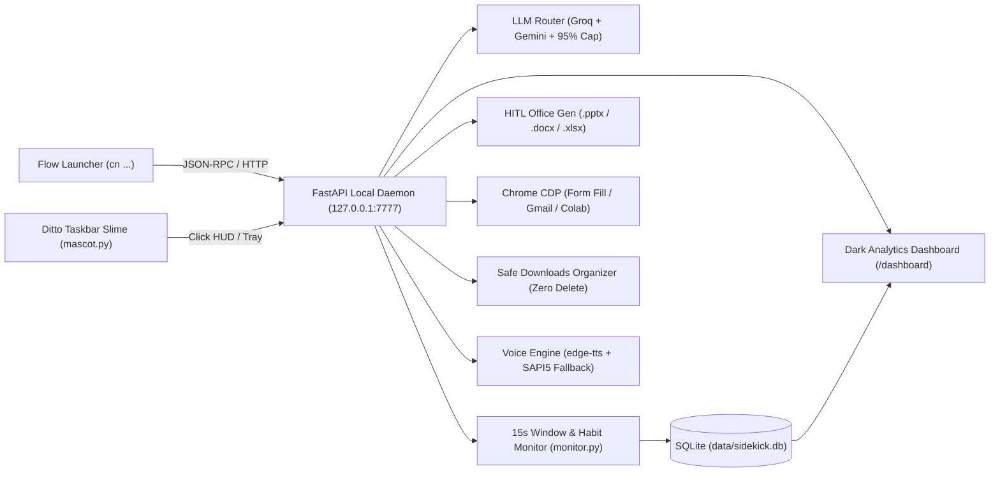

<p align="center">
  
</p>

<h1 align="center">Chitran <span style="font-weight:normal;">(with Ditto)</span></h1>

<p align="center">
  Local-first Windows 11 desktop automation daemon, focus &amp; habit tracker, and HITL document engine — paired with <b>Ditto</b>, an animated taskbar cyber-slime.
</p>

<p align="center">
  
  
  
  
  
  
</p>

---

**Chitran** (*from Chitragupta, the record-keeper*) runs silently on `127.0.0.1:7777` at **₹0/month**, routing between fast Groq LLMs and Gemini free-tier models with strict daily quota caps while keeping all activity logs, goals, and form-fill profiles strictly local.

## Meet Ditto (Live Taskbar States)

Ditto sits directly inside your Windows 11 taskbar (`daemon/mascot.py` + `daemon/byte_art.py`) and shifts appearance in real time based on your system state:

| Focused | Working | Alert | Paused | Hydration | Mail |
| :---: | :---: | :---: | :---: | :---: | :---: |
|  |  |  |  |  |  |
| Monitoring active | Background job running | Overdue goal / distraction | Reminders paused | Water / eye break | Gmail briefing ready |

---

## System Architecture



---

## Command Reference (`Alt + Space` → `cn ...`)

| Command | Action |
| :--- | :--- |
| **`cn goal <task> @ <HH:MM>`** | Logs a daily goal + deadline in SQLite (or opens Deadline / Planner HUD). |
| **`cn done <id or keyword>`** | Marks a pending goal completed. |
| **`cn ask <question>`** | Queries Groq / Gemini mentor and opens a floating dark HUD. |
| **`cn doc` / `excel` / `ppt <topic>`** | Stage 1 **Outline Approval HUD** (slide count, **Revise with AI**, `.pptx` template branding, local Mermaid PNGs, web image search) → compiles to `~/Documents/Sidekick_Outputs/`. |
| **`cn research <topic>`** | Parallel technical web search → Markdown Context Pack + 1-click Copy Prompt HUD. |
| **`cn fill [role]`** | Auto-fills active Chrome form fields from local vault via CDP (never clicks Submit). |
| **`cn mail`** | Summarizes today's Gmail via silent Chrome CDP into a dark HUD + voice briefing. |
| **`cn colab [url]`** | Runs active Google Colab cells in the background with Win+L keepalive lock. |
| **`cn organize` / `cn undo`** | Preview-first Downloads sorter into configured folders with batch undo (`data/undo_log.json`). |
| **`cn stats`** | Opens the dark-mode **Analytics Dashboard** (`http://127.0.0.1:7777/dashboard`) with Day/Week/Month SVG charts, goals, hydration streaks & quota gauges. |
| **`cn pause` / `cn mute` / `cn ditto`** | Toggles monitoring, headphone TTS (`edge-tts` + SAPI5 fallback), or restores Ditto on the taskbar. |
| **`cn kill`** | Emergency brake: aborts background tasks and releases keepalive locks. |

---

## Built-In Engineering Guardrails

- **₹0 Cost Guarantee:** Token/request quota tracker warns at **80%** and hard-stops LLM calls at **95%** of free-tier daily limits (`daemon/quota.py`).
- **Browser `Origin` Guard:** FastAPI middleware blocks requests from external origins (`HTTP 403`), restricting browser access to `127.0.0.1` / `localhost`.
- **Zero Silent Data Loss or Submissions:** `cn organize` never deletes files and logs every move to `data/undo_log.json`; `cn fill` never clicks Submit.
- **Local-First Privacy:** Active-window telemetry, habit events, and notes stay on disk in `data/sidekick.db` and `~/Daily_Notes/` (excluded from Git via `.gitignore`).

---

## Project Structure

```text
├── daemon/
│   ├── server.py           # FastAPI local daemon + localhost Origin guard
│   ├── router.py           # Groq / Gemini routing + 80%/95% daily quota caps
│   ├── monitor.py          # 15s active-window monitor, YouTube classifier, break nudges
│   ├── mascot.py           # Taskbar Ditto slime + system tray controller
│   ├── byte_art.py         # Procedural vector slime frame renderer
│   ├── hud.py              # Floating dark-slate Tkinter HUDs & cheat sheet
│   ├── office_gen.py       # HITL .docx / .xlsx / .pptx builder + Mermaid + image search
│   ├── organizer.py        # Preview-first Downloads sorter + undo support
│   ├── planner.py / planner_ui.py
│   ├── browser.py / form_filler.py / colab_runner.py / gmail_briefing.py
│   ├── researcher.py / analytics.py / voice.py / db.py / state.py / win_ui.py
│   ├── assets/byte2/       # Ditto sprite states
│   └── templates/dashboard.html
├── plugin/
│   ├── plugin.json         # Flow Launcher manifest (keyword: cn)
│   └── main.py             # Stdlib-only Flow Launcher bridge
├── config/organizer_rules.json
├── scripts/
├── USER_GUIDE.md
├── requirements.txt
└── .env.example
```

---

## Quick Setup (Windows 11)

1. **Clone & install dependencies (Python 3.12):**
   ```powershell
   git clone https://github.com/MasterRohitPatil/Chitran.git
   cd Chitran
   pip install -r requirements.txt
   ```
2. **Configure `.env`:**
   Copy `.env.example` to `.env` and add your own free-tier `GROQ_API_KEY` and `GEMINI_API_KEY`.
3. **Link Flow Launcher Plugin (optional):**
   Create a directory junction from `%APPDATA%\FlowLauncher\Plugins\Chitran` to `.\plugin` and restart Flow Launcher. Summon via **`Alt + Space`** → **`cn`**.
4. **Launch Ditto & Daemon:**
   Run `python daemon/mascot.py` (or trigger any `cn` command in Flow Launcher). See [`USER_GUIDE.md`](USER_GUIDE.md) for details.

---

## Author

**Rohit Ganesh Patil**  
B.E. in Artificial Intelligence & Machine Learning (AIML) — SIES Graduate School of Technology, Mumbai  
GitHub: [@MasterRohitPatil](https://github.com/MasterRohitPatil)
