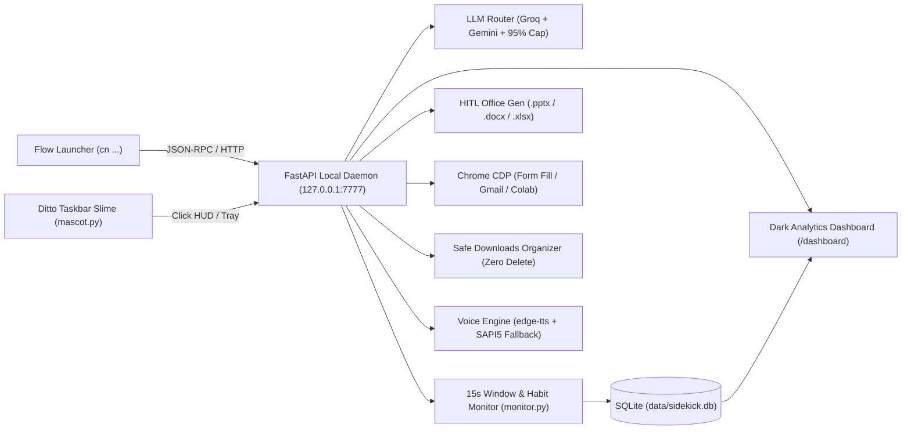

# Chitran (with Ditto)

**Chitran** (*from Chitragupta, the record-keeper*) is a local-first Windows 11 desktop assistant, workflow engine, and focus/habit tracker paired with **Ditto**, an animated cyan cyber-slime mascot that lives directly in your taskbar.

Built in Python with **₹0/month operating cost** using local SQLite storage, local browser automation over Chrome CDP, free-tier LLM routing (Groq + Gemini) with strict daily quota caps, and a Flow Launcher (`cn`) + mouse-driven HUD interface.

---

## Architecture



---

## Key Capabilities

- **Two Ways to Control (`cn` + Ditto):**
  - **Keyboard (`Alt + Space` → `cn <cmd>`):** Instant Flow Launcher plugin (`plugin/main.py` using Python stdlib only).
  - **Mouse (Ditto Mascot):** Procedural vector slime (`daemon/byte_art.py` + `daemon/mascot.py`) pinned inside the Windows 11 taskbar with live states (`FOCUSED`, `WORKING`, `ALERT`, `PAUSED`, `HYDRATION`, `MAIL`).
- **Human-in-the-Loop Office Generator (`cn doc` / `cn excel` / `cn ppt`):**
  - Two-stage workflow: researches the topic, drafts a structured outline, and opens an editable **Outline Approval HUD** before compiling.
  - Supports **Revise with AI**, optional organizer `.pptx` template branding preservation, local offline **Mermaid diagram** rendering via headless Chrome, and web image search.
- **Local Focus & Habit Analytics (`cn stats`):**
  - 15-second local active-window logger (`daemon/monitor.py`) with YouTube study/distraction classification and break nudges.
  - Responsive dark-mode SVG dashboard (`http://127.0.0.1:7777/dashboard`) with Day/Week/Month focus charts, goal completion, hydration streaks, and API quota gauges.
- **Chrome CDP Automation (`cn fill`, `cn mail`, `cn colab`):**
  - Connects to a dedicated Chrome debug profile (`port 9222`) to auto-fill forms from a local vault (never clicks Submit), summarize today's Gmail into a dark HUD + voice briefing, and monitor Google Colab runs.
- **Safe Downloads Organizer (`cn organize` / `cn undo`):**
  - Preview-first file sorting into configured folders with an undo batch log (`data/undo_log.json`) and **zero file deletion**.
- **Parallel Web Researcher (`cn research <topic>`):**
  - Gathers sources into `~/Daily_Notes/context_packs/` and opens a 1-click Copy Prompt HUD.
- **Voice Alerts (`cn say` / `cn mute`):**
  - Neural TTS via `edge-tts` with automatic offline Windows SAPI5 (`pyttsx3`) fallback.

---

## Project Structure

```text
├── daemon/
│   ├── server.py           # FastAPI local daemon + localhost Origin guard
│   ├── router.py           # Groq / Gemini routing + 80%/95% daily quota caps
│   ├── monitor.py          # 15s active-window monitor, YouTube classifier, break nudges
│   ├── mascot.py           # Taskbar Ditto slime + system tray controller
│   ├── byte_art.py         # Procedural vector slime frame renderer
│   ├── hud.py              # Floating dark-slate Tkinter HUDs & cheat sheet
│   ├── office_gen.py       # HITL .docx / .xlsx / .pptx builder + Mermaid + image search
│   ├── organizer.py        # Preview-first Downloads sorter + undo support
│   ├── planner.py / planner_ui.py  # Daily goals & deadline tracker
│   ├── browser.py / form_filler.py / colab_runner.py / gmail_briefing.py
│   ├── researcher.py       # Parallel web research & context packs
│   ├── analytics.py        # Day/Week/Month SQLite aggregator
│   ├── voice.py            # edge-tts + pyttsx3 fallback
│   ├── db.py / state.py / win_ui.py
│   └── templates/dashboard.html
├── plugin/
│   ├── plugin.json         # Flow Launcher manifest (keyword: cn)
│   └── main.py             # Stdlib-only Flow Launcher bridge
├── config/
│   └── organizer_rules.json
├── scripts/
│   ├── launch_chrome_cdp.bat
│   └── start_sidekick.bat
├── USER_GUIDE.md
├── requirements.txt
└── .env.example
```

---

## Quick Setup (Windows 11)

1. **Clone & install dependencies (Python 3.12):**
   ```powershell
   git clone https://github.com/MasterRohitPatil/Chitran.git
   cd Chitran
   pip install -r requirements.txt
   ```
2. **Configure environment variables:**
   Copy `.env.example` to `.env` and add your own free-tier `GROQ_API_KEY` and `GEMINI_API_KEY`.
   *(Your `.env`, `config/profile_vault.json`, and `data/` SQLite/log files are excluded by `.gitignore`.)*
3. **Link Flow Launcher Plugin (optional):**
   Create a directory junction from `%APPDATA%\FlowLauncher\Plugins\Chitran` to `.\plugin`, then restart Flow Launcher. Use **`Alt + Space`** → **`cn`**.
4. **Launch Daemon / Ditto:**
   Run `python daemon/mascot.py` (or trigger any `cn` command in Flow Launcher).
   See [`USER_GUIDE.md`](USER_GUIDE.md) for the full command cheat sheet.

---

## Author

**Rohit Ganesh Patil**  
B.E. in Artificial Intelligence & Machine Learning (AIML) — SIES Graduate School of Technology, Mumbai  
GitHub: [@MasterRohitPatil](https://github.com/MasterRohitPatil)
